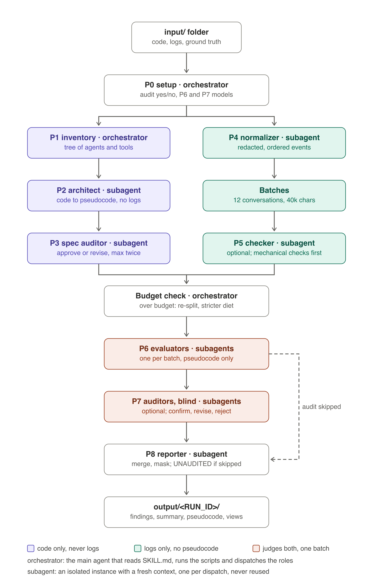

# hallucination-eval

A host-independent Agent Skill that evaluates a tool-using conversational agent for hallucinations. It first turns
the agent's code, prompts and agent-to-tool tree into literate pseudocode and architecture views (a tree, one state
machine per flow, a who-decides-what table, the state-variable bus), then judges every trajectory point by point
against that contract with isolated subagents, and emits one JSON record per conversation with rationale and
evidence locators, plus an audited summary with the MDD-style views (A hallucinated output, B hallucinated argument,
C hallucinated tool, D device grounding).

Everything runs from one folder: `SKILL.md` (the orchestrator contract), `roles/` (subagent prompts), `references/`,
`assets/`, `scripts/` (standard-library Python; `openpyxl` only for xlsx). No host-specific files are required.

## Install

### VS Code GitHub Copilot (Windows, macOS, Linux)

1. Copy this folder into the repository as `.github/skills/hallucination-eval/` (or into
   `%USERPROFILE%\.copilot\skills\hallucination-eval\` for all workspaces). The folder name must stay
   `hallucination-eval`. The setup script does this for you: extract the zip anywhere inside the workspace, then
   run `py -3 hallucination-eval\scripts\setup_skill.py` from the workspace root (`--user` for the home-folder
   location, `--agents` for step 4, `--dry-run` to preview). It copies the folder into place, creates `input/` and
   `output/`, and verifies the copy with `scripts/check_skill.py`.
2. `py -3 -m pip install openpyxl` (only if trajectories come as xlsx).
3. In Copilot chat, agent mode: make sure the run-subagent tool (`agent`) is enabled in Configure Tools. Type `/` to
   see the skill, or just ask: "Evaluate the DemoCard trajectories in `runs/` for hallucinations using the materials in
   `materials/democard`".
4. Optional named agents with tool restrictions: copy `adapters/vscode-copilot/*.agent.md` into `.github/agents/`.
   The orchestrator can then say "Run the hallu-evaluator agent as a subagent with prompt file ...".
5. Leave nested subagents disabled (default).

### Claude Code

Copy the folder into `.claude/skills/hallucination-eval/` (or keep it under `.github/skills/`, which Claude Code
also reads), or run `python3 hallucination-eval/scripts/setup_skill.py --host claude` from the workspace root.
Optional: copy `adapters/claude-code/agents/*.md` into `.claude/agents/` for tool-restricted roles (`--agents` does
it). Invoke with `/hallucination-eval` or by describing the task.

### Codex or another Agent-Skills host

Copy the folder into `.agents/skills/hallucination-eval/` (or run `scripts/setup_skill.py --host codex`). Without a
subagent tool the skill runs in single-agent mode and says so in the output.

## Folder convention

Put everything the skill reads under `input/` and let it write under `output/` (details in
[references/folders.md](references/folders.md)):

```text
input/
  materials/      the CX Agent Studio export folder(s), or loose code, callbacks, prompts, variables.json
  trajectories/   events.jsonl run folders, CES JSON folders, xlsx or csv exports
  ground_truth/   csv/xlsx/json keyed by session id (DemoCard: zip_on_file)
  docs/           optional: workflow introduction, MDD sections, an existing pseudocode
  config/         optional: column_map.json, agents.json, settings.json
output/
  <RUN_ID>/       hallucination_findings.json, summary.md, workflow_pseudocode.md, architecture.md (final)
                  + inventory/, spec/, normalized/, checker/, findings/, notes/, audit/, report/, runtime/
```

`python scripts/manifest.py scan input` tells you what is present and what is missing before anything runs.

## What you provide

| Input | Examples for DemoCard |
|---|---|
| Materials: the CX Agent Studio "Export agent" folder (JSON or YAML flavour: `app.json`, `agents/<name>/<name>.json` with callbacks and `instruction.txt`, `tools/<name>/<name>.json` with `python_function/python_code.py`, `toolsets/`, `guardrails/`), or loose tool code, callbacks, prompts and `variables.json` | `exported_app_DemoCard/DemoCard/` from the console export, or the loose files under `materials/democard` |
| Workflow introduction (optional) | `docs/democard_workflow_intro.md` sections 2 to 7 |
| Existing pseudocode to reconcile (optional) | `docs/democard_pseudocode_v1.md` |
| Trajectories | `runs/replay` and `runs/simulator` (events.jsonl), or a BigQuery xlsx export |
| External ground truth (optional but needed for deterministic outputs) | a csv keyed by session id with `zip_on_file` |

## What you get (in `RUN_DIR`)

Final deliverables at the top of `output/<RUN_ID>/`: `hallucination_findings.json` (the contract in
`references/output_schema.md`), `summary.md` (digits masked), `workflow_pseudocode.md`, `architecture.md` (tree +
Mermaid flows), plus `aggregate.json`, `summary_tables.md` and `run_manifest.json` for resume. Intermediate
products in `inventory/`, `spec/`, `normalized/`, `checker/`, `findings/`, `audit/`, `notes/`, `report/`, `runtime/`.
How to read all of it, file by file and number by number: [docs/interpreting-the-output.md](docs/interpreting-the-output.md).

## Run the pipeline by hand (no subagents), for a smoke test

```bash
python scripts/manifest.py scan input
python scripts/manifest.py init --target DemoCard --input input --output output        # prints RUN_DIR
python scripts/manifest.py paths output/<RUN_ID>                                     # every canonical path
python scripts/inventory_materials.py input/materials --out RUN/inventory/materials_inventory.json --summary RUN/inventory/materials_summary.md
python scripts/build_spec.py tree --inventory RUN/inventory/materials_inventory.json --out RUN/inventory/materials_tree.md
# write RUN/workflow_pseudocode.md (see references/example_democard_excerpt.md), then:
python scripts/build_spec.py compile RUN/workflow_pseudocode.md --out RUN/spec/workflow_spec.json --report RUN/spec/spec_report.md --inventory RUN/inventory/materials_inventory.json
python scripts/build_spec.py render RUN/spec/workflow_spec.json --out RUN/architecture.md --inventory RUN/inventory/materials_inventory.json
python scripts/normalize_trajectories.py normalize input/trajectories/<entry> --out RUN/normalized [--ground-truth input/ground_truth/<file>]
python scripts/normalize_trajectories.py split RUN/normalized/conversations.json --out RUN/normalized/batches
# evaluate each batch into RUN/findings/batch_NNN.json, then audit, then:
python scripts/make_audit_payload.py payload --findings RUN/findings/batch_001.json --conversations RUN/normalized/conversations.json --out RUN/audit/payload_batch_001.json
python scripts/make_audit_payload.py apply --findings RUN/findings/batch_001.json --verdicts RUN/audit/verdicts_batch_001.json --out RUN/findings/verified_batch_001.json
python scripts/merge_findings.py --verified-dir RUN/findings --out RUN/hallucination_findings.json --manifest RUN/run_manifest.json --pseudocode RUN/workflow_pseudocode.md --conversations RUN/normalized/conversations.json
python scripts/validate_findings.py RUN/hallucination_findings.json --conversations RUN/normalized/conversations.json --resolve-locators
python scripts/aggregate_findings.py RUN/hallucination_findings.json --out RUN/aggregate.json --md RUN/summary_tables.md --mdd-view
python scripts/report_summary.py --findings RUN/hallucination_findings.json --aggregate RUN/aggregate.json --spec RUN/spec/workflow_spec.json --manifest RUN/run_manifest.json --out RUN/summary.md
```

(`RUN` stands for `output/<RUN_ID>`.)

## Tests and self-check

```bash
python -m unittest discover -s tests -p "test_*.py"
python scripts/check_skill.py --tests
```

## Design notes

- The run is a state machine kept in `run_manifest.json`: phases with prerequisites and artifact gates (`manifest.py
  gate`, guarded `set-phase`), per-batch states, and one dispatch record per subagent instance with an attempt
  limit. Resume with `manifest.py next`.
- Isolation is enforced where a script decides what a role receives (one batch, a blind audit payload, prompts that
  name only allowed files, no trajectory path for the architect) and verified after the fact with
  `scripts/leak_check.py` where it can only be instructed.

- The pseudocode is derived from code only; the architect never sees a log, so consistent hallucinations cannot
  become part of the specification. Log-vs-spec disagreements are reported as spec drift.
- Every element carries `author` (model or code) and `provenance` (seen_in_code, inferred, unknown). Hallucination
  rates are computed over model-authored points; code-authored mismatches are pipeline findings.
- Evaluators see one batch; auditors verify blind (the evaluator's rationale is withheld) and sample supported
  points for a miss-rate estimate; evaluator precision comes from the auditor's rejections.
- The normalizer redacts secrets (bearer tokens, JWTs, secret-named values, card numbers) and caps payloads before
  a batch is written, and drops the full-state copies that made voice logs ten times larger than their content;
  evaluators and auditors read the pseudocode only. `scripts/context_budget.py` measures what each subagent will
  read before it is dispatched.
- Whether the P7 audit runs is asked first; without it the run ends after P6 and the summary is marked UNAUDITED.
- The models that run the P6 evaluators and the P7 auditors are asked first, each a single choice (GPT-5.5, Claude
  Opus 4.8, Claude Opus 4.7, Claude Sonnet 5.0), recorded in the manifest and the final file, and on VS Code Copilot
  pinned into the named agents (`scripts/setup_skill.py --agents --evaluator-model "<P6>" --auditor-model "<P7>"`).
- Scripts are standard-library Python with explicit UTF-8, pathlib paths and ASCII console output so they behave the
  same on Windows.

## Workflow overview



The editable source is `docs/hallucination-eval-overview-0.4.0.svg`.

## License

Apache License 2.0. See [LICENSE](LICENSE) and [NOTICE](NOTICE).
